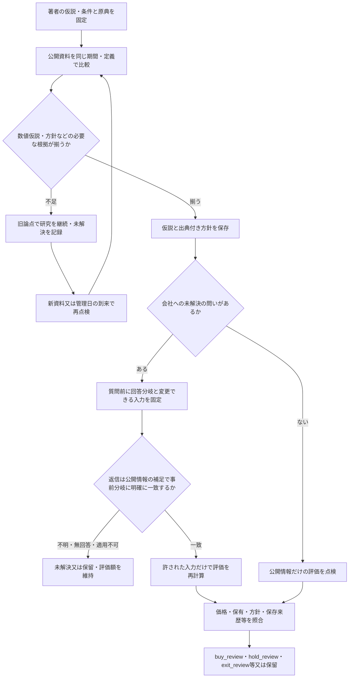

# IRを使う研究と投資判断の処理

[判断方針](decision-policy.md)と[CLI契約](workflow.md)の関係を示す。

## 現在の処理の流れ

以下は本プロジェクトで採用する運用手順を図示したもの。著者が指定しない数値条件を作らず、会社定義の確認と金融判断を分ける。旧APIを含む全経路で同じ項目が必須という意味ではなく、実際の要件はCLI契約で確認する。

研究段階の確認と管理日は[別枠の点検](research-stage-monitoring.md)で扱う。正式質問・返信・判断の詳細な必須項目、版の整合と保留条件は[CLI契約](workflow.md)に従う。図は外部送信・発注・定時Web取得を実行する機能を表していない。

不足を扱うときは[著者資料15例の能力比較v6](../research/ir-author-source-capabilities-2026-10-15/README-v6.md)で必要な資料の役割を選び、[10社31タスクv4](../research/ir-issue-owner-backlog-2026-10-15/README-v4.md)で答えの主体と依存を分ける。会社定義の研究草案を作れても、数量関係や評価前提まで揃ったとはしない。未取得・未確認を非公表へ置き換えず、公開で答えが得られた草案は廃止又は限定する。

