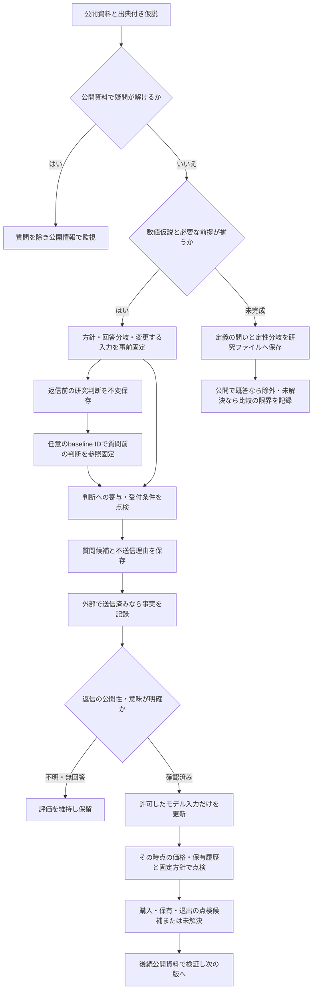

# IRで変わった前提から判断まで

金融上の採用元は[Anthropicの仮説・反証・シナリオ管理](decision-policy.md)、[Damodaranの評価モデル](financial-equity-valuation-spec.md)、[既存の情報価値分析](../research/ir-policy-adoption-2026-10-15/README.md)。以下の記録順序と状態遷移は、それらを本プロジェクトへ適応したもの。

このCLIは送信・発注を行わない。返信前の分岐案 `precommitted_action` と、価格まで点検した `action` を区別する。公開性を訂正した場合は、以前の判断を不変履歴として残しながら現在の表示を保留し、依存する仮説を再調査する。

[返信前の研究判断](research-decision-reviews.md)は返信がなくても保存できる。[baseline IDの参照固定](question-baseline-binding.md)は任意だが、利用する場合は質問の作成前に保存し、仮説・方針・価格・有効な保有状態を一致させる。後から質問へ追加しない。返信前後の価格や時点が違う結果を比較しただけでは、差をIRの効果と認定できない。

数値仮説が未完成の研究も進められるが、現在の`question add`は保存済みthesis版を必要とし、thesisはvaluation・価格を必須とする。登録のために予測や倍率を作らず、定義の草案と回答が変える比較範囲を会社別ファイルに残す。数値path変更のない質問自体は禁止しておらず、`parameter_paths: []`も受理する。定義が分かっただけで企業仮説を反証済みや売却候補へ飛ばさない。

この段階の研究は、[新しい保存資料と既存管理日の点検](research-stage-monitoring.md)から公開情報の確認へ戻る。明示登録したcaseでは、[定性レビューのqueue](qualitative-research-jobs.md)が新しい保存資料と根拠付き管理日の到来をjobへ接続する。通常dailyや任意の研究ファイル全体を自動監視する機能ではなく、Webの定時取得や外部schedulerは別途必要になる。分類済みという状態だけで、著者条件への影響まで確認済みにはしない。

## どの数値があると何を計算できるか

| 入力 | 計算・点検できるもの | 不足するものは補わない |
|---|---|---|
| 出典付きの各シナリオのモデル入力 | EPS倍率、FCFF、DDMの各評価額と提示範囲 | 会社予想1期分だけでは将来の配当列や安定期は完成しない。 |
| 各シナリオの確率 | 確率加重の期待評価額 | 未設定なら明示的なunweightedモードで各評価額だけを計算する。均等確率や平均で埋めない。 |
| 保存された反証、対象シナリオ、下落幅条件、現在価格と保有状態 | 反証、目標到達、提示シナリオの下落幅による既存方針の点検 | 確率がなくても計算可能な条件と、期待値が必要な条件を区別する。 |
| 期待評価額と明示された費用・最低上昇余地・下落幅条件 | 新規購入の条件の点検 | 期待値が未設定なら、この購入条件はunresolved。 |
| 状態別効用、事前確率、費用、IRの状態別応答尤度 | EVSIによる質問の条件付き価値 | 尤度がなければEVPI上限まで。返信を完全情報と扱わない。 |

`unweighted` の最低・最高評価は提示したシナリオの範囲であり、信頼区間や損失の統計的上限ではない。すべての点検は入力したモデルと方針に条件付く。数値計算の成功から、モデルの適合・予測の正しさ・超過収益を推定しない。

資本収益率も定義を固定する。[公開実装の確認](../research/ir-transparent-metric-core-review-2026-10-15/README.md)では、歴史税前のGreenblatt型ROC、税率を加工する歴史税後ROIC、[安定期再投資](cyclical-reinvestment-spec.md)が使う将来の税後新規投資ROCは別の入力だった。営業利益とEBIT、純資産と実装のequityも自動で対応させない。会社IRで確認する公表指標の意味と、投資家が採用する計算定義・税率・将来利回りを分け、既存ライブラリの代替処理を回答後に暗黙適用しない。

## 実企業で確認できた違い

- [IIJ](../research/ir-case-studies-2026-10-15/3774/README.md)：CAPEXの定義は追加公開資料で解け、追加質問の判断への寄与を説明できず不送信。
- [パイオラックス](../research/ir-case-studies-2026-10-15/5988/followup-public-review/README.md)：配当方針の期限・EPS/DPSの対象期は公開情報で閉じる。約6億円と減損337百万円の包含・期間は未確認で、会計上の足戻しや将来費用消失を仮定しない。残る草案は判断への影響が未設定のため送信候補にしない。
- [千葉銀行](../research/ir-case-studies-2026-10-15/8331/README.md)：会社予想の年間DPSは確認できたが、DDMの将来配当列・資本コスト・安定期や資本配賦は未充足。一般FAQの資本比率を当該行の実績や目標へ置き換えない。窓口は未確認。

- [日本冶金工業](../research/ir-case-studies-2026-10-15/5480/disclosed-facts/README.md)：過年度の連結営業利益1件を原文から構造化したが、全サイクル・再投資・最新性が未確認のため正常利益や評価額へ転用しない。

詳細な入力契約は[操作手順](workflow.md)、段階別の作業は[運用設計](ir-operation-design.md)を参照する。
