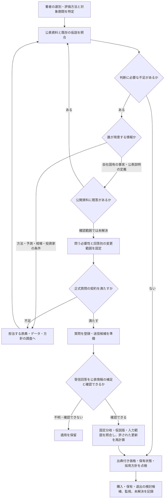

# 著者の方針からIR質問と判断へ進む

採用する著者の方針を先に決め、公開情報で仮説を作り、回答によって何が変わるかを固定してから質問を選ぶ。以下は[採用済みの調査手順](decision-policy.md)をこのハーネスへ適応した流れであり、著者がこのIR戦略の成績を検証したものではない。

各分岐の意味は研究担当が原文と対象範囲を確認する。図がその意味を自動認証するわけではない。質問の登録、外部での送信、回答の受信、売買注文は別の操作で、このハーネスは送信・発注を実行しない。

## 不足を引き受ける担当

| 不足 | 次に確認する先 | 会社IRへ求めるもの |
|---|---|---|
| 会社の認識基準・事業指標・公表値の対象範囲 | 同期の決算資料、注記、公開Q&A。その後に必要な定義を限定 | 公表説明の意味や参照箇所。未公表進捗や達成保証にしない |
| 評価式、比較対象、PER・β等の測定仕様 | 方法の著者、計算・データの提供者の原典 | 外部著者の仕様を会社に確定させない |
| 将来利益・成長・CFの予測 | 採用方法が必要とする会社予想、外部予測、根拠付き明示仮定 | 数値の不足だけを理由に新たな将来予測を要求しない |
| 価格・売買代金等の観測 | 対象時点・株式基準が分かる市場データ | 株価や価格到達を保証させない |
| 許容損失・費用・保有・購入と退出条件 | 利用者の条件または適用対象が合う採用済み外部方針 | 投資家側の判断条件を会社の回答で置き換えない |

外部の会社別予測は全方法の共通必須条件ではない。一方、方法を選んだことだけでは、その方法に必要な実入力が揃ったことにはならない。出典のない値を補って処理を進めない。

## 実資料で通した分岐

| 事例 | 得られた根拠 | 次の処理 |
|---|---|---|
| [2410](../research/ir-case-studies-2026-10-15/2410/native-case-setup-2026-10-16/actual-inputs/parent-acceptance.json) | 最新通知と公開Q&Aで上場維持結果、普通・特別配当、取消認識を確認 | 既答を質問から除く。会社の3,000円目標を投資家の利確価格にしない |
| [2983](../research/ir-case-studies-2026-10-15/2983/damodaran-relative-method-input-mapping-2026-10-16/ir-followup-disposition.json) | 著者の回帰式と一般定義を追加確認したが、取消集計の回答から5年成長率へ変換する経路は未設定 | 既存の取消定義案を再開しない。方法・予測・測定入力の調査へ戻す |
| [2983の同業表](../research/ir-case-studies-2026-10-15/2983/domestic-peer-table-reproduction-2026-10-16/parent-acceptance.json) | 著者が選んだ10社の表示PER平均を再現 | 原表の比較値として保持。平均を公正倍率や目標価格へ自動採用しない |
| [2459](../research/ir-case-studies-2026-10-15/2459/model-scope-review-2026-10-16/parent-acceptance.json) | 負の当期EPS、通期予想未定、既存事業の損失継続を確認 | 当期EPSによる通常PE適用を見送る。収益化と資金の公開根拠を先に調べる。会社全体の永久除外とはしない |

## 金融判断との接続

現行の数値判断にはvaluation付き仮説、6項目の方針、出典と時点を確認した価格・保有状態等の契約がある。これは[プロジェクトの実行契約](decision-policy.md)であり、すべての定性研究に著者が要求した条件ではない。

正式質問では[公開確認と回答分岐](ir-question-preparation.md)を先に固定する。曖昧な回答・回答不能・無回答は、仮説否定や価値0の代わりにせず、未解決として扱う。回答の有無とは独立に[公開情報だけの基準判断](research-decision-reviews.md)を残し、後でIRが実際に変えた入力と判断を比較する。
